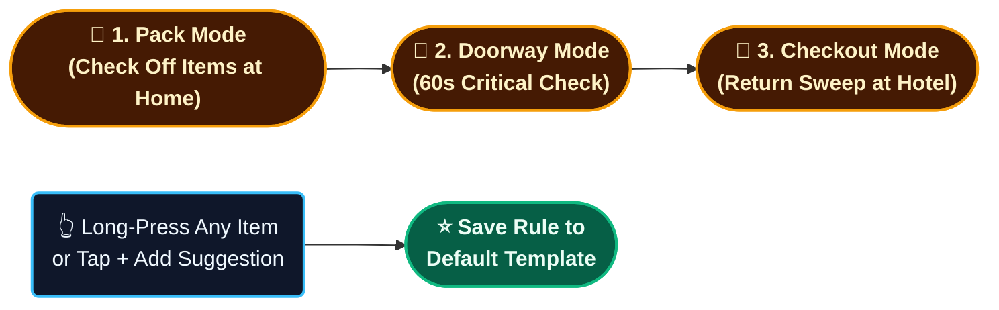
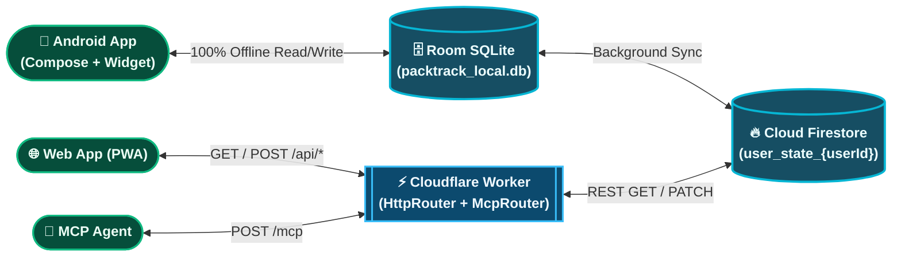
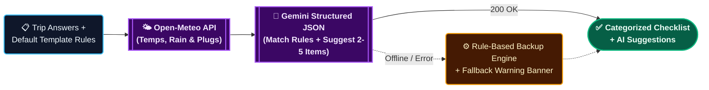

# 🎒 PackTrack

An open-source, AI-powered trip packing and lifecycle tracking assistant backed by **Google Gemini** (`v1beta/models` dynamic cascade & Structured Outputs), **Open-Meteo Weather**, **Android Room SQLite**, **Firebase Cloud Firestore**, **Cloudflare Workers**, and a **Model Context Protocol (MCP) Server**.

---

## Features

- **4-Screen Native Android & Cloudflare Edge Web Flow:**
  - **Home Dashboard (`HomeScreen.kt` / `WebAppView.js`):** Minimalist trip cards showing relative start date (`In 3 days`), duration (`4d`), temperature range (`44°–56°F`), and packed count (`14/18`), plus a slide-out **Settings & Menu** drawer for your Cloud Profile, Default Template Editor, and Accent Theme swatches.
  - **Step-by-Step Trip Interview (`GeminiInterviewScreen.kt`):** Interactive voice/text/chip interview that asks only relevant questions: **Destination** → **Exact Dates** (fetches live Open-Meteo forecast) → **Flight or Own Car?** (skips bag limits if driving) → **Rental Car?** → **Bags** → **Work or Leisure?**.
  - **Trip Checklist (`TripChecklistScreen.kt`):** Segmented **Pack | Doorway | Checkout** mode switcher, progress bar, categorized items with quantity pills (`×1`, `×5`), bottom **✨ Gemini Weather & Trip Suggestions** (`+ Add` / `✕`), and **long-press on any item** to save it permanently to your Default Template.
  - **Default Template Editor (`TemplateEditorScreen.kt`):** View, add, or remove permanent rules across built-in and custom user-created categories (`On Me`, `Docs`, `Electronics`, `Toiletry`, `Clothes`, `Medicines`, `Others`, plus any custom category you create). Supports natural-language rule conditions.
- **3-Phase Trip Lifecycle Modes:**
  - **🧳 Pack:** Full categorized checklist with weather- and duration-scaled clothing counts (`Personal`, `Carry-On`, `Checked Bag`).
  - **🚪 Doorway:** Filters to must-have departure essentials right before walking out the door.
  - **🏨 Checkout:** Separate return-trip checkmarks (`packedReturn`) that pin high-loss items (chargers, travel documents) to the top.
- **Public Gemini App & Home Widget Integration:** Share trip plans directly from the Android Gemini app via the system Share Sheet (`ACTION_SEND`), launch via `packtrack://create` deep links, or use the 1-tap Home Screen voice widget.
- **Offline-First + Cloud Sync:** Works 100% offline on flights using local SQLite (`Room` on Android / `packtrack.db` in Python) and syncs per-user profiles to **Firebase Cloud Firestore** (`packtrack_state/user_state_{userId}`).

---

## App Screens

<p align="center">
  
</p>

---

## Critical User Journeys (CUJ)

### 1. Plan a New Trip (Conditional Interview → Checklist)


### 2. Pack, Travel & Grow Your Default Template



---

## High-Level Design (HLD)

### 1. Client Touchpoints & Cloud Sync



### 2. Checklist Generation Pipeline (Weather + Gemini + Fallback)



---

## Quick Start

### 1. Native Android App (`android/`)

```bash
cd android
# Optional in git-ignored android/local.properties:
# GEMINI_API_KEY=your_gemini_api_key
# FIREBASE_PROJECT_ID=your_firebase_project_id
# DEFAULT_USER_ID=your_username_or_email
./gradlew testDebugUnitTest assembleDebug
adb install -r app/build/outputs/apk/debug/app-debug.apk
```

### 2. Deploy Cloudflare Worker Web App (`cloudflare/`)

1. Connect this repository in **Cloudflare Workers & Pages** (or deploy via Wrangler CLI):
   ```bash
   npx wrangler secret put FIREBASE_PROJECT_ID
   npx wrangler secret put GEMINI_API_KEY
   npx wrangler secret put GOOGLE_CLIENT_ID
   npx wrangler secret put ALLOWED_EMAILS
   npx wrangler deploy
   ```
   *(Note: `keep_vars = true` is enabled in [`wrangler.toml`](wrangler.toml) so git pushes never overwrite variables or secrets configured in your Cloudflare Dashboard).*

### 3. Automated CI/CD & Password-Protected Signed APK (`.github/workflows/android-apk.yml`)

Every push to `main` builds a release-signed APK with an auto-incrementing `versionCode` (`1.0.<run_number>`), locks it inside a password-protected archive (`PackTrack-Protected.zip` encrypted with `KEYSTORE_PASSWORD`), and optionally distributes it via **Firebase App Distribution** when the following GitHub Actions secrets are configured:
- `ANDROID_KEYSTORE_BASE64` & `KEYSTORE_PASSWORD`
- `GOOGLE_CLIENT_ID`, `ALLOWED_EMAILS`, and `GOOGLE_SERVICES_JSON`
- `GEMINI_API_KEY` & `FIREBASE_PROJECT_ID`

### 4. Local Python Companion Server & Evals (`packtrack/` & `tests/`)

```bash
# Launch local companion web UI on http://localhost:8090
python3 -m packtrack.server

# Run all Python + Cloudflare JS engine unit tests and evals
python3 -m unittest discover -s tests -v
```

---

## Project Structure

```text
PackTrack/
├── android/               # Native Kotlin + Jetpack Compose Android App, Room DB, Firebase SDK & Home Widget
├── cloudflare/            # Serverless Cloudflare Worker Web App, REST API, Gemini Cascade & HTTP MCP Server
├── packtrack/             # Python Core Rule Engine, Open-Meteo Service, Companion Web UI & stdio MCP Server
└── tests/                 # Unit tests & evals for work/laptop rules, compound rules, JSON schemas & model cascade
```

---

## License

MIT
