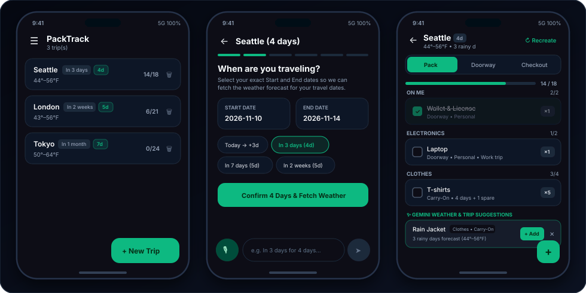
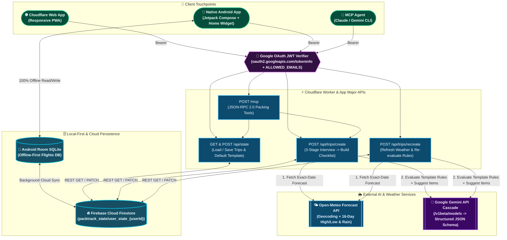

# 🎒 PackTrack

An open-source, AI-powered trip packing and lifecycle tracking assistant backed by **Google Gemini** (`v1beta/models` dynamic cascade & Structured Outputs), **Open-Meteo Weather**, **Android Room SQLite**, **Firebase Cloud Firestore**, **Cloudflare Workers**, and a **Model Context Protocol (MCP) Server**.

---

## Features

- **4-Screen Native Android & Cloudflare Edge Web Flow:**
  - **Home Dashboard (`HomeScreen.kt` / `WebAppView.js`):** View or delete saved trip plans, switch user profiles (`👤 Switch`), manage your Default Template, or start a new trip with Gemini.
  - **3-Stage Gemini Trip Interview (`GeminiInterviewScreen.kt`):** Interactive voice/text/chip interview covering **Stage 1** (Destination & exact Departure/Return Dates + live Open-Meteo weather lookup), **Stage 2** (Transport Mode: Own Vehicle vs. Rental Vehicle vs. No Car/Transit, and Work vs. Leisure), and **Stage 3** (Luggage Space: Personal Item Only vs. Carry-On vs. Checked Bag vs. 2 Checked Bags).
  - **Trip Checklist (`TripChecklistScreen.kt`):** Live weather banner with 1-tap refresh (`🔄 Refresh`), collapsible AI-Suggested Additions card (`+ Add` / `✕`), visible fallback warning banner if Gemini is offline (`⚠️ Gemini is unavailable — rule-based backup results were used`), manual item edits, and **long-press on any item** to save it permanently to your Default Template (`⭐ Add to Default Template`).
  - **Default Template Editor (`TemplateEditorScreen.kt`):** View, add, or remove permanent rules (with confirmation prompts) across built-in and custom user-created categories (`On Me`, `Docs`, `Electronics`, `Toiletry`, `Clothes`, `Medicines`, `Others`, plus any custom category you create). Supports arbitrary natural-language rule conditions (e.g., *"Only add this when there is at least one rainy day and if trip is for more than 5 days and only when we go to India"*).
- **Generalized Live Gemini Model Cascade & Structured Output:**
  - Dynamically discovers available models via `GET /v1beta/models` (cached 1h), filters out non-text modalities (`-image`, `nano-banana`, `omni`, `tts`, `transcribe`, `live`, `gemma`) and legacy `< 3.0` models, and ranks general text models in tier-first order (`gemini-flash-latest` → `gemini-3.8-flash` → `gemini-3.6-flash` → `gemini-3.5-flash-lite` → `gemini-3.1-flash-lite` → `gemini-flash-lite-latest` → `gemini-4-argon`).
  - Enforces strict JSON schema validation via `generationConfig.responseSchema` (`responseMimeType: "application/json"`), dynamically injecting user-created custom categories into the schema `enum`.
- **3-Phase Trip Lifecycle Modes:**
  - **🧳 Pack Outbound:** Full categorized checklist with weather- and duration-scaled clothing counts (`Personal`, `Carry-On`, `Checked Bag`).
  - **🚪 60-Second Doorway Check:** Filters to must-have departure essentials right before walking out the door.
  - **🏨 Hotel Checkout Sweep:** Separate return-trip checkmarks (`packedReturn`) that pin high-loss items (chargers, travel documents) to the top.
- **Public Gemini App & Home Widget Integration:** Share trip plans directly from the Android Gemini app via the system Share Sheet (`ACTION_SEND`), launch via `packtrack://create` deep links, or use the 1-tap Home Screen voice widget.
- **Google Sign-In & Email Allowlist Security:** Built-in Google OAuth Sign-In (`GOOGLE_CLIENT_ID`) on both Web (`accounts.google.com/gsi/client`) and Android (`play-services-auth` `GoogleSignIn`), backed by server-side JWT verification (`oauth2.googleapis.com/tokeninfo`) and `ALLOWED_EMAILS` allowlist enforcement.
- **Multi-Tenant Offline-First + Cloud Sync:** Works 100% offline on flights using local SQLite (`Room` on Android / `packtrack.db` in Python), syncs per-user profiles to **Firebase Cloud Firestore** (`packtrack_state/user_state_{userId}`), and packages password-protected release-signed APK builds (`PackTrack-Protected.zip`).

---

## App Screens & Usage Pattern (Critical User Journey)

<p align="center">
  
</p>

### 1. App Usage Pattern (CUJ Flow)

```mermaid
flowchart LR
    classDef userNode fill:#065f46,stroke:#10b981,stroke-width:2px,color:#ecfdf5,font-weight:bold
    classDef authNode fill:#1e1b4b,stroke:#818cf8,stroke-width:2px,color:#e0e7ff,font-weight:bold
    classDef screenNode fill:#0f172a,stroke:#38bdf8,stroke-width:2px,color:#f0f9ff
    classDef aiNode fill:#3b0764,stroke:#c084fc,stroke-width:2px,color:#faf5ff,font-weight:bold
    classDef modeNode fill:#451a03,stroke:#f59e0b,stroke-width:2px,color:#fef3c7
    classDef dbNode fill:#083344,stroke:#22d3ee,stroke-width:2.5px,color:#ecfeff,font-weight:bold

    Start(["👤 Open Web or Android App"]):::userNode --> Auth{{"🔐 Google Sign-In Gate\n(OAuth JWT + Allowlist)"}}:::authNode
    Auth -->|"Verified Email"| Home(["🏠 Home Dashboard\n(Saved Trips + Default Template)"]):::screenNode

    Home -->|"Tap + New Trip"| Stage1(["📍 Stage 1: Destination & Dates\n+ Live Open-Meteo Weather"]):::screenNode
    Stage1 --> Stage23(["🚗 Stage 2 & 3: Car Mode,\nWork/Leisure & Luggage Space"]):::screenNode

    Stage23 --> GeminiEval[["🤖 Gemini Structured Output\n(Evaluate Rules + Weather Suggestions)"]]:::aiNode
    GeminiEval --> Checklist(["✅ Trip Checklist Screen\n(+ Collapsible AI Suggestions)"]):::screenNode

    Checklist --> Modes{"🔄 3 Lifecycle Modes"}:::modeNode
    Modes -->|"Phase 1"| Outbound(["🧳 Pack Outbound\n(Scaled by Days & Weather)"]):::userNode
    Modes -->|"Phase 2"| Doorway(["🚪 60s Doorway Check\n(Critical Essentials Only)"]):::userNode
    Modes -->|"Phase 3"| Hotel(["🏨 Hotel Checkout Sweep\n(High-Loss Return Items)"]):::userNode

    Checklist -->|"Long-Press Any Item:\n⭐ Save to Default Template"| Firestore[("🗄️ Room SQLite &\nCloud Firestore DB")]:::dbNode
    Outbound & Doorway & Hotel --> Firestore
```



---

## High-Level Design (Website & App Major APIs)



---

## Quick Start

### 1. Native Android App (`android/`)

```bash
cd android
# Optional in git-ignored android/local.properties:
# GEMINI_API_KEY=your_gemini_api_key
# FIREBASE_PROJECT_ID=your_firebase_project_id
# DEFAULT_USER_ID=your_username_or_email
./gradlew testDebugUnitTest assembleDebug
adb install -r app/build/outputs/apk/debug/app-debug.apk
```

### 2. Deploy Cloudflare Worker Web App (`cloudflare/`)

1. Connect this repository in **Cloudflare Workers & Pages** (or deploy via Wrangler CLI):
   ```bash
   npx wrangler secret put FIREBASE_PROJECT_ID
   npx wrangler secret put GEMINI_API_KEY
   npx wrangler secret put GOOGLE_CLIENT_ID
   npx wrangler secret put ALLOWED_EMAILS
   npx wrangler deploy
   ```
   *(Note: `keep_vars = true` is enabled in [`wrangler.toml`](wrangler.toml) so git pushes never overwrite variables or secrets configured in your Cloudflare Dashboard).*

### 3. Automated CI/CD & Password-Protected Signed APK (`.github/workflows/android-apk.yml`)

Every push to `main` builds a release-signed APK with an auto-incrementing `versionCode` (`1.0.<run_number>`), locks it inside a password-protected archive (`PackTrack-Protected.zip` encrypted with `KEYSTORE_PASSWORD`), and optionally distributes it via **Firebase App Distribution** when the following GitHub Actions secrets are configured:
- `ANDROID_KEYSTORE_BASE64` & `KEYSTORE_PASSWORD`
- `GOOGLE_CLIENT_ID`, `ALLOWED_EMAILS`, and `GOOGLE_SERVICES_JSON`
- `GEMINI_API_KEY` & `FIREBASE_PROJECT_ID`

### 4. Local Python Companion Server & Evals (`packtrack/` & `tests/`)

```bash
# Launch local companion web UI on http://localhost:8090
python3 -m packtrack.server

# Run all Python + Cloudflare JS engine unit tests and evals
python3 -m unittest discover -s tests -v
```

---

## Project Structure

```text
PackTrack/
├── android/               # Native Kotlin + Jetpack Compose Android App, Room DB, Firebase SDK & Home Widget
├── cloudflare/            # Serverless Cloudflare Worker Web App, REST API, Gemini Cascade & HTTP MCP Server
├── packtrack/             # Python Core Rule Engine, Open-Meteo Service, Companion Web UI & stdio MCP Server
└── tests/                 # Unit tests & evals for work/laptop rules, compound rules, JSON schemas & model cascade
```

---

## License

MIT
