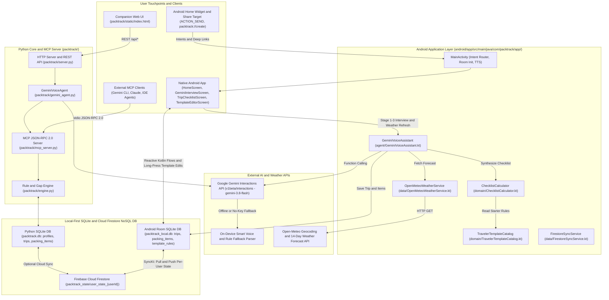
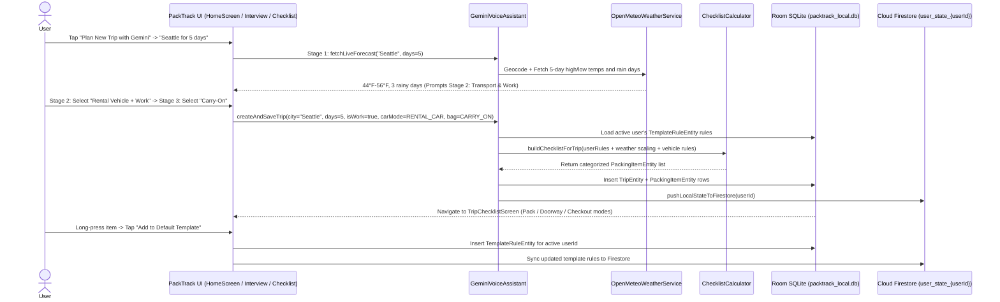

# 🎒 PackTrack

An open-source, AI-powered trip packing and lifecycle tracking assistant backed by **Google Gemini** (`v1beta/interactions`), **Open-Meteo Weather**, **Android Room SQLite**, **Firebase Cloud Firestore**, and a **Model Context Protocol (MCP) Server**.

---

## Features

- **4-Screen Native Android & Companion Web Flow:**
  - **Home Dashboard (`HomeScreen.kt`):** View or delete saved trip plans, switch user profiles (`👤 Switch`), manage your Default Template, or start a new trip with Gemini.
  - **3-Stage Gemini Trip Interview (`GeminiInterviewScreen.kt`):** Interactive voice/text/chip interview covering **Stage 1** (Destination & Duration + live weather lookup), **Stage 2** (Transport Mode: Own Vehicle vs. Rental Vehicle vs. Transit, and Work vs. Leisure), and **Stage 3** (Bag Space: Personal Item Only vs. Carry-On vs. Checked Suitcase).
  - **Trip Checklist (`TripChecklistScreen.kt`):** Live weather banner with 1-tap refresh (`🔄 Refresh`), manual item edits, and **long-press on any item** to save it permanently to your Default Template (`⭐ Add to Default Template`).
  - **Default Template Editor (`TemplateEditorScreen.kt`):** View, add, or remove permanent rules across 7 categories (`Basics`, `Documents`, `Office / Work`, `Clothes`, `Tech & Chargers`, `Toiletries & Health`, `Packing & Travel Gear`).
- **3-Phase Trip Lifecycle Modes:**
  - **🧳 Pack Outbound:** Full categorized checklist with weather- and duration-scaled clothing counts.
  - **🚪 60-Second Doorway Check:** Filters to must-have departure essentials right before walking out the door.
  - **🏨 Hotel Checkout Sweep:** Separate return-trip checkmarks (`packedReturn`) that pin high-loss items (chargers, travel documents) to the top.
- **Public Gemini App & Home Widget Integration:** Share trip plans directly from the Android Gemini app via the system Share Sheet (`ACTION_SEND`), launch via `packtrack://create` deep links, or use the 1-tap Home Screen widget.
- **Multi-Tenant Offline-First + Cloud Sync:** Works 100% offline on flights using local SQLite (`Room` on Android / `packtrack.db` in Python) and syncs per-user profiles to **Firebase Cloud Firestore** (`packtrack_state/user_state_{userId}`).

---

## High-Level Design (HLD) & Architecture

### 1. System Architecture



### 2. End-to-End Trip Interview & Lifecycle Sequence



---

## Quick Start

### 1. Native Android App (`android/`)

```bash
cd android
# Optional in git-ignored android/local.properties:
# GEMINI_API_KEY=your_gemini_api_key
# FIREBASE_PROJECT_ID=your_firebase_project_id
# DEFAULT_USER_ID=your_email_or_profile_id
./gradlew assembleDebug
adb install -r app/build/outputs/apk/debug/app-debug.apk
```

### 2. Deploy Cloudflare Worker Web App (`cloudflare/`)

1. Connect this repository in **Cloudflare Workers & Pages** (or deploy via Wrangler CLI):
   ```bash
   npx wrangler secret put FIREBASE_PROJECT_ID
   npx wrangler deploy
   ```

### 3. Python Companion Web UI & MCP Server (`packtrack/`)

```bash
# Launch local web UI on http://localhost:8090
python3 -m packtrack.server

# Run automated unit tests
python3 -m unittest discover -s tests -v
```

---

## Project Structure

```text
PackTrack/
├── android/               # Native Kotlin + Jetpack Compose Android App, Room DB & Home Widget
├── cloudflare/            # Serverless Cloudflare Worker Web App, REST API & HTTP MCP Server
├── packtrack/             # Python Core Rule Engine, Open-Meteo Service, Web UI & MCP Server
└── tests/                 # Unit tests for weather, template rules, and voice agent workflow
```

---

## License

MIT
